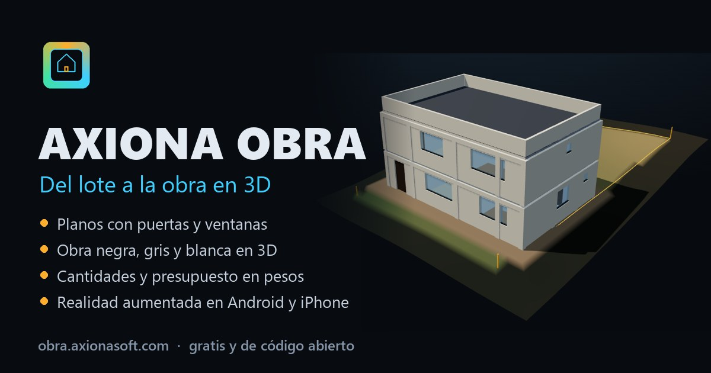

# Axiona Obra · del lote al juego de planos, el 3D amoblado y la obra

**Úsala gratis:** https://obra.axionasoft.com. Funciona en el navegador del computador, en Android y en iPhone. Se instala como app y abre sin señal.



**¿Falta medir el terreno?** [Axiona Topo](topo/README.md) (https://topo.axionasoft.com) lo mide con el GPS, la cámara o una cinta, saca niveles con la mira, curvas y movimiento de tierra, y abre el lote aquí con un toque.

Escribes el lote o lo mides con el celular, eliges el país y escribes los espacios que quieres. Con eso, Axiona Obra hace el trabajo de mesa que antes tomaba semanas. El profesional habilitado lo **lee, verifica y firma**.

## Qué hace

1. **País (Colombia, España, Canadá o México).** Cada uno carga lo suyo:
   - normas y trámites antes de construir, con sus fuentes;
   - moneda y unidades (en Canadá, pies y pulgadas);
   - sistema constructivo: pórticos de concreto o mampostería confinada (NSR-10 Título E o NTC de mampostería en México), hormigón y ladrillo, o entramado de madera con sótano;
   - techo típico, formato de láminas, quién firma y precios calibrados con rangos de mercado.
2. **Terreno.** Calcula:
   - área, linderos con azimut y pendiente;
   - curvas de nivel, plataforma, corte y relleno;
   - retiros e índices;
   - capacidad portante del estudio de suelos, sismo, nieve y helada.
3. **Programa.** Reparte los espacios en la huella:
   - pone muros, puertas, ventanas, escalera y ascensor;
   - escoge la mejor de muchas distribuciones posibles;
   - revisa en automático los espacios sin puerta o sin ventana, las proporciones, el Título E de la NSR-10, la Parte 9 en Canadá y la NCSE-02 en España.
4. **Juego de planos en PDF.** Son unas 15 láminas como las de una oficina:
   - portada con índice, localización y cuadro de áreas;
   - una planta por piso con muebles, cotas, ejes y códigos de puertas y ventanas;
   - planta de cubierta, cuatro fachadas y dos cortes;
   - cimentación y replanteo;
   - planos eléctricos e hidrosanitarios;
   - cuadros de puertas, ventanas y acabados;
   - detalles constructivos y resumen de presupuesto.

   Cada lámina lleva rótulo, firmas y matrícula, sello oficial, revisiones y su código según la costumbre del país. La escala se escoge sola. También sale en DXF para AutoCAD.
5. **Interiores.** Hay cinco estilos: moderno, cálido, lujo, nórdico y campestre. Cada uno pone pisos, enchapes, maderas y telas. La casa se amobla sola (camas, sofás, comedor, cocina, baños, clósets, cortinas, cuadros, plantas y jardín); cada mueble se puede quitar.
6. **Modelo 3D.** Tiene once fases, del terreno a la entrega amoblada. También permite:
   - verla sin techo, piso por piso;
   - recorrerla a pie;
   - usar el ascensor por voz («piso tres» o «third floor») sin perder los botones.
7. **Presupuesto.** Muestra:
   - las partidas de cada país;
   - los costos indirectos: AIU con IVA sobre la utilidad, gastos generales con beneficio e IVA, u overhead con imprevistos e impuesto;
   - cuánto cuesta el m² frente al rango del mercado;
   - los materiales principales y el cronograma.
8. **Adjuntar documentos.** Lee un PDF con texto (estudio de suelos, norma urbanística, escrituras, memoria), un DXF o un .txt. Saca medidas, linderos, capacidad portante, desplante, retiros, pisos, alcobas, propietario, predio y profesionales. Cada dato muestra el fragmento de donde salió, para que una persona lo apruebe antes de aplicarlo.
9. **Ventas.** Arma el condominio: lotes a lado y lado de una vía, con la casa en cada lote y su estado (libre, reservado o vendido). El cliente lo ve en 3D o como maqueta en realidad aumentada, escoge su lote y entra caminando a la casa.
10. **Domótica.** En Canadá trae las opciones del frío: sensores de fuga y congelamiento, cables antihielo, respaldo eléctrico y monitor de radón. En México, el nivel de cisterna y tinaco con aviso al celular (agua por tandeo) y el receptor de alerta sísmica en cada nivel. En los otros países trae cerradura, iluminación, persianas, cámaras y paneles solares. Todo sale en el plano eléctrico y en el presupuesto.
11. **¿El proyecto va bien encaminado?** Un semáforo junta:
    - los trámites;
    - los avisos del diseño;
    - el costo por m²;
    - los profesionales en el rótulo;
    - la aprobación del profesional.
12. **Axi, el asistente holográfico.** Un botón flotante abre a Axi, que escucha, habla y cambia el proyecto por ti:
    - entiende órdenes en español, como «agrega dos alcobas y un baño en el segundo piso», «pon 3 pisos», «porcelanato en toda la casa», «muéstrame los ladrillos» o «descarga el PDF»;
    - responde dudas sobre la app, como la licencia, el estudio de suelos o la diferencia con Revit, y dice con honestidad lo que todavía no hace;
    - funciona sin internet y sin modelo de lenguaje, con un cerebro local que tiene pruebas (`tests/asistente.test.js`);
    - si el equipo lo permite, se le puede activar un cerebro avanzado: el modelo de Chrome o Qwen 2.5 con WebLLM, corriendo en el propio navegador, sin API ni costo por pregunta;
    - lleva al formulario de reseñas, propuestas y soporte, que llega al panel de Netlify, y a WhatsApp y correo cuando se configuran en `src/asistente/contacto.js`.
13. **Editar sobre el plano.** Al tocar un espacio en la planta se puede cambiar su nombre, su área, su piso y su zona, o duplicarlo o eliminarlo. El motor vuelve a distribuir el piso.
14. **Forma del edificio.** Además de la caja recta, los pisos de arriba pueden retroceder del de abajo:
    - escalonada al frente, de un lado o en los dos sentidos, con un retroceso por piso de 1 a 6 m;
    - cada retroceso deja una terraza con piso exterior, baranda de vidrio y materas;
    - los pisos altos pueden llevar balcones de 1,2 m al frente, y la ventana del espacio pasa a puerta-ventana;
    - la base crece lo necesario para que cada piso quepa con su programa, la fachada nueva de cada piso cae sobre un eje, y las columnas y vigas paran donde el piso retrocede;
    - el 3D, las plantas, las fachadas, los cortes, la planta de cubierta, el DXF y el presupuesto salen con la forma (impermeabilización, piso exterior y baranda; en México, en los números generadores).

    Se escoge en Programa › Forma del edificio o se le pide a Axi: «hazla escalonada con terrazas», «terraza lateral», «agrega balcones». Pruebas en `tests/formas.test.js`.

### México

Lo que una constructora mexicana hace a mano en hojas de cálculo, aquí sale del mismo modelo:

- **Trámite.** En la CDMX dice si la obra es manifestación de construcción tipo A, B o C (artículo 51 del Reglamento) y por qué no es tipo A cuando no lo es. También dice si lleva DRO y Corresponsable en Seguridad Estructural. Fuera de la CDMX la lista de pasos cambia a licencia municipal.
- **Mampostería confinada.** Pone castillos en cada nivel a no más del menor de 4 m y 1.5 H, con dalas y zapata corrida dimensionada por la capacidad del suelo. Revisa la regularidad de la planta y nombra, por eje, los muros de arriba que no apoyan en muros de abajo.
- **Losa de vigueta y bovedilla.** El peralte (12+4, 15+5 o 20+5) sale del claro que gobierna. En marcos, ese claro es el de los tableros entre trabes.
- **Agua.** Calcula ocupantes y dotación, una cisterna común con días de reserva, un tinaco por vivienda y la bomba, en capacidades que se venden.
- **Catálogo de conceptos con números generadores.** Cada concepto lleva clave, unidad y precio unitario. Se abre para ver sus renglones por nivel y eje, con largo, ancho, alto, piezas y lo que se descuenta. La cantidad es la suma exacta de su generador.
- **Explosión de insumos y FSR.** Calcula concreto, block, cemento, arena, grava, armex, vigueta y bovedilla. El factor de salario real (LFT 2026) se calcula con el jornal que escribas.
- **Indirectos e IVA.** Indirectos, financiamiento y utilidad van encadenados. El IVA de 16 % solo grava la parte no habitacional, porque la casa habitación construida con materiales y mano de obra está exenta.
- **Láminas.** Llevan claves A, E, IE, IHS y PR, y formato de 90 × 60 cm. Los números generadores salen en CSV para Excel.

Exporta el juego de planos en **PDF** y **DXF**, la vista actual en **SVG**, el modelo en **GLB** y **USDZ**, el presupuesto en **CSV** (en México también los números generadores) y el proyecto en **JSON**. «Compartir» mete el proyecto entero en un enlace. Nada se sube a ningún servidor.

Hecho por [Axiona Desarrollos Inteligentes S.A.S.](https://axionasoft.com) (Sabaneta, Colombia).

## In English

Axiona Obra turns a lot and a room list into a preliminary design package for **Colombia, Spain, Canada or Mexico**. It includes:
- a complete PDF drawing set (plans, elevations, sections, roof, foundation, electrical, plumbing, schedules, details), with title blocks ready for the professional's seal;
- a furnished 3D model with a walkthrough and a voice-controlled elevator;
- an AR site visit;
- a country-specific budget and permit checklist;
- a document reader that pre-fills fields from PDFs;
- a subdivision tool for sales offices.

Canadian projects use feet and inches, Part 9 wood-frame with basement, and English sheets (A0.0, A1.0, A2.1…). Mexican projects get the Mexico City permit type (A, B or C), confined-masonry tie columns, joist-and-block slab depth, water storage sizing and a priced bill of quantities with a line-by-line take-off. It is free, open source and runs fully in the browser.

## Desarrollo

```bash
npm install
npm run dev        # http://localhost:8160
npm test           # pruebas del motor (Vitest)
npm run build      # versión pública en dist/
```

| Carpeta | Qué hay |
|---|---|
| `src/motor/` | Cálculo puro, sin DOM, que se prueba en Node: geometría, países, distribución, amoblado, redes, cubierta, fachadas y cortes, cuadros, cantidades, cronograma, domótica, lector de documentos, loteo y México (`mexico.js`: trámite, castillos, losa, agua, generadores y FSR). |
| `src/ui/` | Planos SVG, láminas y PDF, dibujo de primitivas, lector de archivos y enlace para compartir. |
| `src/vista3d/` | 3D con [three.js](https://threejs.org): fases, texturas hechas por programa, muebles, recorrido, ascensor y condominio. |
| `src/ar/` | Realidad aumentada: WebXR en Android y AR Quick Look en iPhone. |
| `src/exportar/` | DXF, CSV, GLB y USDZ. |
| `tests/` | Pruebas del motor. |

## Alcance y responsabilidad

Es **predimensionamiento para anteproyecto y estimación**:
- Las cargas son supuestas (1,0 t/m² por nivel).
- Las columnas se predimensionan por número de pisos.
- Las zapatas salen de la capacidad portante.
- Las redes son esquemáticas.

El diseño estructural, el estudio de suelos, los diseños de redes y la licencia o permiso los firman profesionales habilitados en cada país:
- **Colombia:** NSR-10 y Ley 400 de 1997.
- **España:** CTE y Código Estructural.
- **Canadá:** el código de construcción de la provincia.
- **México:** el Reglamento de Construcciones y sus Normas Técnicas Complementarias, o el reglamento del municipio. Firman el DRO y los corresponsables.

Hasta que el profesional marca el proyecto como revisado y aprobado, cada lámina dice «Anteproyecto · para revisión». Los precios son de referencia y hay que reemplazarlos por cotizaciones. Las normas y los trámites se verificaron en octubre de 2026 con las fuentes que muestra la app, y cambian: hay que confirmarlos con la autoridad local.

## Licencia

[MIT](LICENSE) © Axiona Desarrollos Inteligentes S.A.S. Motor 3D: three.js (MIT). PDF: jsPDF y svg2pdf.js (MIT). Lectura de PDF: pdf.js (Apache 2.0).
